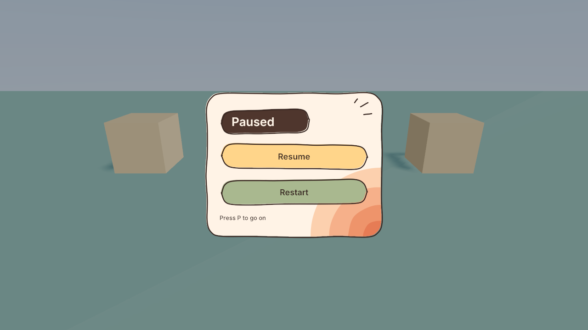

# Creating a Pause Menu

A menu with art that opens on a key press, freezes the game and has Resume and Restart buttons. No script needed, in Lua or Rust projects. About 20 minutes.

| Folder | What's in it |
| --- | --- |
| [guide/](guide/step-by-step.md) | The step-by-step guide |
| [assets/](assets/) | The four images as `.png`, their editable `.svg` originals, and the picture above |

**You need:** a project with a scene, and the four `.png` images in `assets/`. To use your own art, keep the same image shapes.

## How it works

- **Pause Menu** starts disabled, so nothing shows and its buttons do nothing.
- **Pause Controller** is an empty object that listens for the P key and changes the game state. It is not inside the menu, because a disabled object's rules don't run.
- When the state becomes Paused, a rule enables the menu. When it becomes Playing, a rule disables it.
- **`pause_open`** is a variable that remembers whether the menu is open, so one key can both open and close it.

## Limits

- Buttons on images have no hover or press effect.
- Images stretch to fit, including their corners, so resize them only a little.
- No rule can quit the game, so a Quit button needs a script.
